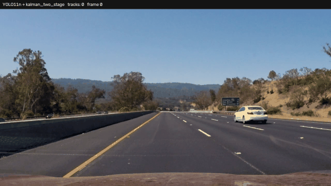
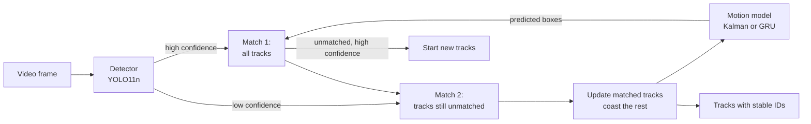

# Video-Based Driving Perception

A camera perception pipeline for driving video: vehicle detection, multi-object tracking built from scratch, and a learned temporal motion model. The tracker is scored on real KITTI tracking sequences, against baselines, with a held-out test set.



*YOLO11n detections with the Kalman two-stage tracker on dash-cam video. The numbers are persistent track IDs, and the lines show recent motion. This footage has no ground truth, so it shows behavior, and the scores below come from KITTI.*

## How it works



- **Detection:** pretrained YOLO11n (COCO car, bus and truck classes).
- **Tracking:** predict each track's next box, match by IoU with the Hungarian algorithm, then update or coast. This is written from scratch in [`tracker.py`](src/perception/tracker.py).
- **Two-stage matching:** as in ByteTrack, low-confidence detections can continue an existing track but can't start a new one. This keeps objects through partial occlusion without letting noise create tracks.
- **Temporal modeling:** a Kalman filter or a small GRU predicts the next box. The GRU has 4,260 parameters and sees recent motion and image position. Simulated detector noise and missed frames during training teach it to coast through gaps. It runs in plain NumPy at inference, and a test checks that it matches PyTorch.

## Results

### Tracking on KITTI (held-out test set)

Six sequences (13, 14, 15, 16, 18, 19) with 3,476 scored car instances. They were set aside before any results were seen, and settings were chosen only on separate tuning sequences.

| Method | IDF1 | MOTA | ID switches | Fragments | Recall | Precision |
|---|---:|---:|---:|---:|---:|---:|
| IoU only (baseline) | 0.852 | 0.865 | 16 | 73 | 0.894 | 0.973 |
| Kalman | 0.879 | 0.869 | 6 | 77 | 0.898 | 0.970 |
| **Kalman + two-stage** | **0.894** | **0.889** | 19 | **39** | **0.925** | 0.968 |
| GRU | 0.880 | 0.870 | 5 | 72 | 0.891 | 0.978 |
| GRU + two-stage | 0.892 | 0.886 | 15 | 39 | 0.923 | 0.966 |

What this shows:

- **Motion prediction helps identity.** Moving from IoU to Kalman cut ID switches from 16 to 6 and raised IDF1 by 0.027.
- **Two-stage matching is a tradeoff.** It halved fragmentation (77 to 39) and raised recall, but ID switches rose from 6 to 19, and 11 of those came from sequence 14.
- **The GRU didn't improve end-to-end tracking.** It roughly tied the tuned Kalman filter, so the simpler Kalman two-stage tracker is the one used in the video demo. At 10 FPS, boxes move little between frames, so a better long-range prediction may not change many matches.

### Motion prediction on KITTI (held-out test set)

This tests the temporal models directly. Each one sees 5 frames, then predicts up to 5 frames ahead with no new measurements, as a tracker does through a missed detection. There are 491 non-overlapping windows, and each score is the mean IoU with the true future box.

| Method | Clean: 1 frame | 3 frames | 5 frames | Noisy: 1 frame | 3 frames | 5 frames |
|---|---:|---:|---:|---:|---:|---:|
| Last position | 0.898 | 0.774 | 0.690 | 0.844 | 0.734 | 0.656 |
| Constant velocity | **0.978** | **0.899** | **0.821** | 0.806 | 0.616 | 0.464 |
| Kalman | 0.966 | 0.888 | 0.812 | 0.871 | 0.759 | 0.652 |
| GRU | 0.934 | 0.855 | 0.774 | **0.893** | **0.820** | **0.741** |

"Noisy" adds simulated Gaussian jitter of 3% of box size to the inputs, to resemble detector output. Clean inputs are ground-truth labels.

- **With noisy inputs, the GRU is the most accurate.** At 5 frames it beats Kalman by 0.089 IoU (95% bootstrap interval 0.080 to 0.100).
- **With perfect inputs, simple physics wins.** Constant velocity is best, and the GRU trails Kalman by about 0.04 at 5 frames (interval -0.049 to -0.028).
- **The result depends on the scenes.** On the tuning sequences, the GRU beat Kalman at 3 and 5 frames even on clean inputs.

### Video demo

On the 50-second highway clip, processed at 12.5 FPS on a 2-core CPU with no GPU:

| Measure | Value |
|---|---|
| Detector time | 54 ms per frame |
| Tracker time | 0.46 ms per frame |
| Tracks reported | 28 |
| Longest track | 344 frames (about 27 seconds) |

## Limitations

- **The KITTI scores don't use a camera detector.** The KITTI images weren't available in the environment used for this work, so tracking is scored on published PointRCNN detections, which are LiDAR-based boxes projected into the image. This measures the tracker, not YOLO11n. Camera detections would likely score differently.
- **Video settings are hand-set.** YOLO's confidence scale differs from PointRCNN's, so the KITTI-tuned thresholds don't carry over. The demo's accuracy isn't measured.
- **The scoring is KITTI-style, not official.** It uses KITTI's care rules with `py-motmetrics` at IoU 0.5, cars only. It isn't the official devkit and doesn't include HOTA, so these numbers shouldn't be compared with the KITTI leaderboard.
- **The test set is small.** It has six sequences, and they're uneven. Sequence 13 has just 22 scored instances, so its per-sequence numbers swing widely. Differences of a few ID switches aren't meaningful.
- **There's no re-identification.** A car that's hidden for longer than `max_age` frames comes back with a new ID. In the full video, the white car appears to get a new ID this way after the black car overtakes it.
- **No camera-motion compensation.** Ego motion is only handled implicitly, which matters most when turning.

## Quick start

```bash
python -m venv .venv && source .venv/bin/activate
pip install -e ".[dev,video]"
python scripts/download_data.py     # KITTI labels and detections, video, and YOLO weights

pytest -q                                    # unit tests, which need no data
python scripts/evaluate_tracking.py --split test   # reproduce the tracking table
python scripts/evaluate_forecast.py --split test   # reproduce the motion table
python scripts/run_video.py --start 18 --seconds 14 --gif assets/tracking.gif --gif-width 560 --gif-fps 8
```

To repeat the full process, including retraining and tuning:

```bash
python scripts/train_motion.py      # about 2 minutes on CPU
python scripts/tune_tracker.py      # tries 972 settings, about 45 minutes on 2 cores
```

## Project layout

```
src/perception/
  tracker.py    predict, two-stage matching, track lifecycle
  motion.py     stationary, Kalman and GRU motion models
  boxes.py      IoU and box conversions
  kitti.py      data loading and the fixed splits
  metrics.py    MOT metrics with KITTI's ignore rules
  factory.py    named tracker configurations
scripts/        download, train, tune, evaluate, and run on video
models/         trained GRU weights
results/        every number in this README, as JSON
assets/         demo GIF
tests/          synthetic scenes with known answers
```

## Data splits

| Purpose | KITTI tracking sequences |
|---|---|
| Fit the GRU | 0, 2, 3, 4, 5, 9, 17, 20 |
| GRU early stopping, Kalman noise tuning | 7, 11 |
| Choose tracker settings | 1, 6, 8, 10, 12 |
| Final test | 13, 14, 15, 16, 18, 19 |

## Data and licenses

Datasets aren't included in this repository. They're downloaded at pinned versions.

- **KITTI tracking labels:** [CC BY-NC-SA 3.0](https://www.cvlibs.net/datasets/kitti/), non-commercial. The GRU weights in `models/` are trained on them, so treat those as non-commercial too.
- **PointRCNN detections and label copies:** from [AB3DMOT](https://github.com/xinshuoweng/AB3DMOT), under a non-commercial research license.
- **Demo video:** from [Udacity's CarND-Vehicle-Detection](https://github.com/udacity/CarND-Vehicle-Detection), under the MIT license.
- **YOLO11n and the `ultralytics` package:** [AGPL-3.0](https://github.com/ultralytics/ultralytics). This repository's code is also under AGPL-3.0 for that reason.
